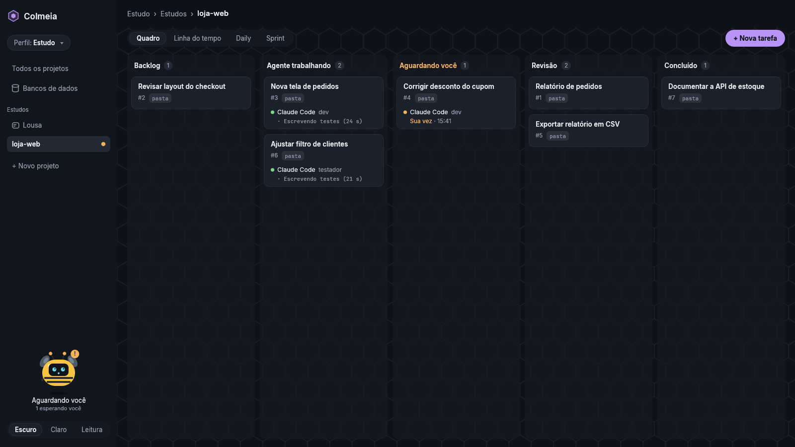
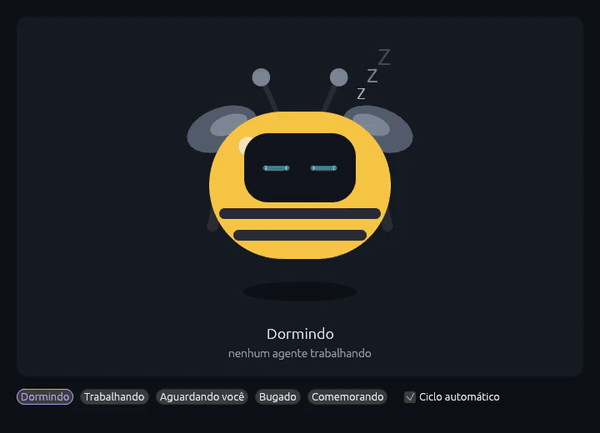
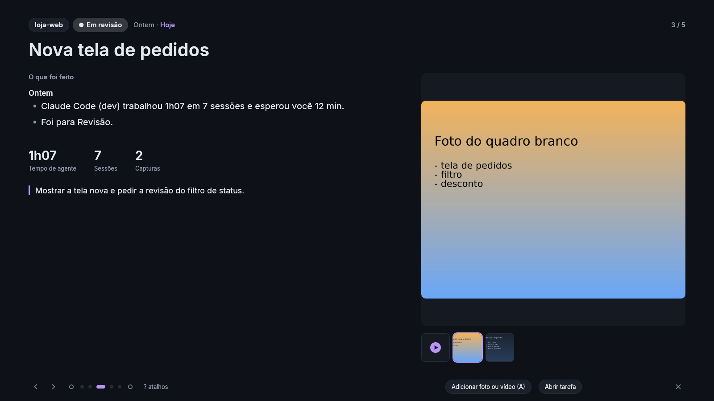
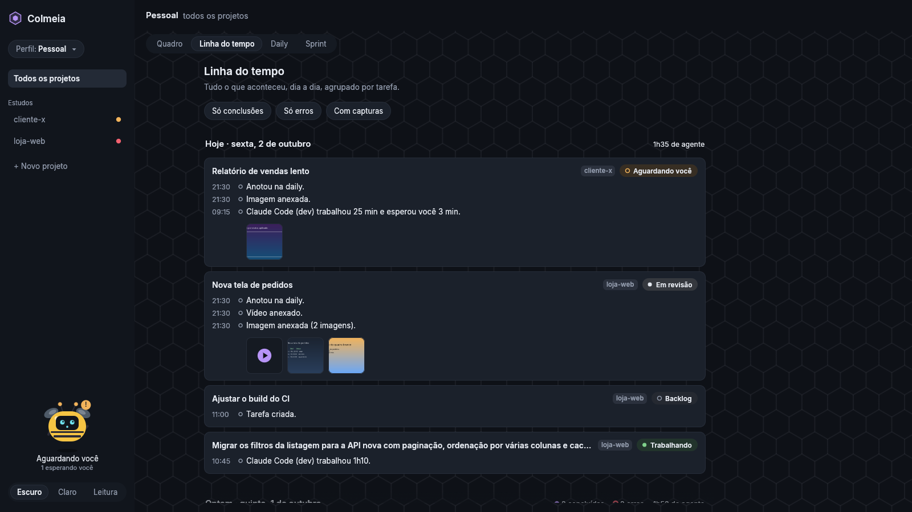
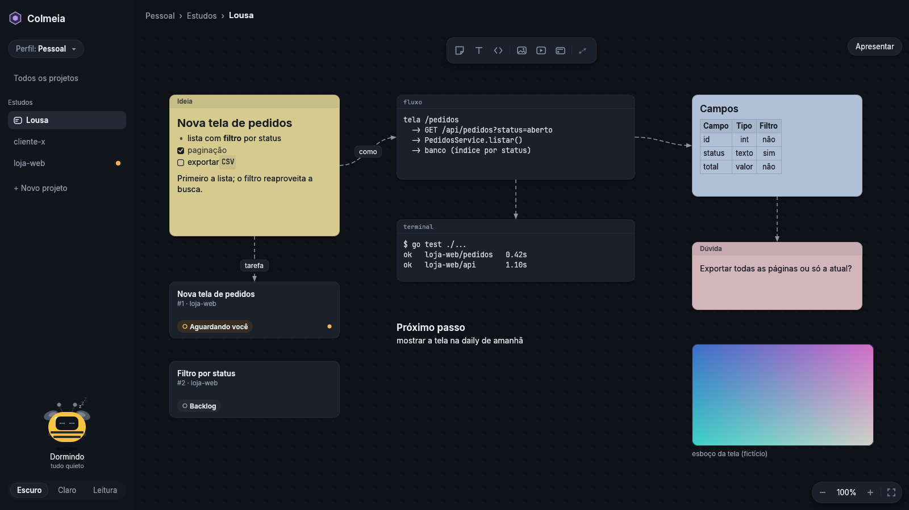
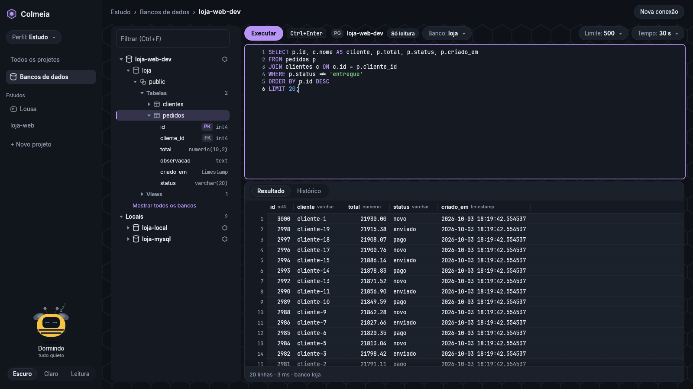

# Colmeia

Colmeia é um app desktop para coordenar vários agentes de IA de código trabalhando ao mesmo tempo.

Com um agente escrevendo testes, outro ajustando uma tela e outro investigando um bug, o trabalho passa a depender de quem acompanha todos eles. São muitos terminais abertos, contexto copiado de um lado para o outro e pouca visibilidade sobre qual agente está esperando uma resposta. A Colmeia reúne isso num só lugar. Cada projeto tem um quadro de tarefas, cada tarefa tem os seus agentes (Claude Code, Codex, Gemini CLI, OpenCode) com o terminal integrado, e uma abelha no canto da tela avisa quando algum deles precisa de você. O que acontece ao longo do dia fica registrado e pronto para a daily e para a sprint.



Roda no Linux e no Windows e é de código aberto.



## Instalação

Cada versão publicada tem os binários para Linux e Windows (x86_64) na página de releases, com o `SHA256SUMS` ao lado.

No Linux:

```bash
sha256sum -c SHA256SUMS
mkdir colmeia && tar -xzf colmeia-linux-x86_64.tar.gz -C colmeia
./colmeia/instalar.sh   # instala em ~/.local/bin, com atalho e ícone, sem sudo
```

No Windows 10 (1803 ou mais novo) ou 11, extraia o `colmeia-windows-x86_64.zip` e rode, no PowerShell, de dentro da pasta extraída:

```powershell
powershell -ExecutionPolicy Bypass -File .\instalar.ps1   # instala em %LOCALAPPDATA%\Programs\Colmeia, com atalho no menu Iniciar
```

Se preferir compilar, os passos estão em [Desenvolvimento](#desenvolvimento).

A Colmeia tem duas partes. A janela é apenas a interface. Quem cuida dos terminais é o núcleo, um processo em segundo plano que a janela inicia sozinha. Por isso, fechar a janela não interrompe os agentes, que continuam trabalhando (e consumindo a sua conta de IA). Se houver agente rodando, a Colmeia pergunta se é para fechar só a janela ou parar tudo. Para encerrar o núcleo de vez, use `colmeia-nucleo --encerrar`.

Os dados ficam em `~/.local/share/colmeia/` no Linux e em `%LOCALAPPDATA%\Colmeia\dados` no Windows, acessíveis apenas pelo seu usuário.

## Primeiros passos

Na primeira execução, a Colmeia pede a criação de um perfil. Perfis separam contextos, como trabalho e estudo, cada um com os seus projetos, contas de IA e tema (escuro, fosco, claro ou leitura). A Colmeia detecta as ferramentas de IA instaladas, e cada uma pode usar a conta do sistema ou uma conta exclusiva do perfil.

Em seguida, adicione um projeto. Pode ser um repositório git ou qualquer pasta, que não é alterada ao ser adicionada.

Para falar com um agente, crie uma tarefa em "+ Nova tarefa", abra a tarefa e clique em **Adicionar agente**. O terminal do Claude Code abre dentro da tarefa. É possível digitar diretamente nele ou usar a caixa de mensagem embaixo, que envia com Enter (Shift+Enter quebra a linha), aceita imagens coladas e lembra das mensagens anteriores com a seta para cima.

Os cartões podem ser arrastados entre colunas, e o botão direito (ou o "⋯") mostra as demais ações.

Na barra lateral, os projetos ficam agrupados por workspace. Clicar no nome do workspace mostra todos os projetos dele juntos, e a seta ao lado recolhe o grupo. Um workspace recolhido continua sinalizando, com um ponto colorido, quando algum agente dele precisa de você.

## O que dá para fazer

### Quadro e agentes

Numa tarefa de repositório git, o agente pode trabalhar direto na pasta do projeto ou numa cópia isolada, um git worktree na branch da tarefa. Assim, dois agentes não interferem no trabalho um do outro.

Uma tarefa pode ter vários agentes. O que está em foco aparece em tempo real e os outros viram miniaturas. Se você começou uma conversa com o Claude Code no IntelliJ ou num terminal, **Retomar conversa** lista as que ele guardou para aquela pasta e retoma de onde parou.

O cartão mostra o que cada agente está fazendo, com a mesma cor e o mesmo texto no quadro, no painel e na abelha.

| Estado | Como aparece |
| --- | --- |
| Trabalhando | ponto verde e a última linha do terminal |
| Pede aprovação | "Parece pedir aprovação · desde 14:32" |
| Sua vez | "Sua vez · desde 14:32" |
| Quer consultar o banco | um pedido esperando a sua aprovação |
| Parado | "Parado desde 14:10" |
| Terminou ou deu erro | "Terminou às 14:40", "Parou com erro (código 1) às 14:40" |

O estado "Sua vez" é uma estimativa. Depois de alguns segundos sem saída, a Colmeia considera que o agente terminou e aguarda você, por isso a tela usa "parece" ([decisão 0005](docs/decisoes/0005-estado-do-agente-por-heuristica.md)). O cartão se move automaticamente entre "Agente trabalhando" e "Aguardando você"; quando todos os agentes da tarefa terminam bem, vai para Revisão, e quando um agente com papel revisor termina bem, para Concluído. Se você mover o cartão, ele fica onde você pôs. Se você parar um agente pela tela, a Colmeia pergunta o que fazer com a tarefa. A marca "sozinha" no cartão diz em que ponto desse caminho ele está.

Ao lado do nome do projeto, o resumo ("2 esperam você · 1 trabalhando · 1 com erro") destaca no quadro só as tarefas de cada grupo. A etiqueta do cartão sai do começo da branch (funcionalidade, correção, docs, main), sem nada para configurar. O Concluído mostra só o que terminou hoje; o resto fica no Histórico.

Quando algo precisa de você em outra tarefa, aparece um aviso no rodapé. Com a janela em segundo plano, o título vira "Colmeia · 2 esperando você". Ctrl+Shift+P leva direto ao próximo agente que está esperando.

### A abelha e a abelha fixa

A abelha no pé da barra lateral resume o perfil: dorme, trabalha, espera você, dá erro ou comemora, e o clique abre o que está acontecendo. Em Ajustes, **Abelha** escolhe o acabamento dela entre cinco (Colmeia, Clássica, Redonda, Favo e Zangão) e o nome, Colmeia por padrão, que aparece no resumo e nos balões.

**Fixar a abelha na área de trabalho** abre o `colmeia-abelha`, um programa à parte, pequeno e sem moldura, sempre por cima e em todas as áreas de trabalho, que continua lá com a janela da Colmeia fechada (o núcleo segue rodando). Parada, ela mostra um ponto da cor do que mais pede você, ou um contador vermelho com os erros. O clique abre o resumo ("2 esperam você · 1 trabalhando · 0 com erro"), que fica até você fechar, com a tarefa que pede você, Abrir a Colmeia e Desafixar. Quando um agente espera você, dá erro ou uma tarefa é concluída, um balão sai dela e some em 8 s (parado com o mouse em cima). Abrir e Ver o erro levam à tarefa na janela aberta ou abrem a Colmeia já nela. A abelha se arrasta e lembra onde ficou, e só redesenha quando algo muda. No Wayland ela fica por cima só onde o compositor deixa, como uma janela comum ([decisão 0013](docs/decisoes/0013-abelha-fixa-em-programa-a-parte.md)).

### Ditado por voz

Em Ajustes, **Ditado por voz** (desligado por padrão) mostra o tamanho do modelo (148 MB) e, se você aceitar, baixa uma vez o Whisper base multilíngue do repositório oficial do whisper.cpp, com barra de progresso e Cancelar. O arquivo é conferido pelo SHA-256 antes de ser usado. Ligado, aparece um microfone ao lado do Enviar na caixa de mensagem da tarefa: clique para começar e de novo para parar, ou segure Ctrl+Shift+M enquanto fala. Com o microfone aberto, o botão fica vermelho e a dica diz "Microfone ligado". O texto entra na caixa para você revisar e nunca é enviado sozinho.

A transcrição roda no computador, em português, sem internet e sem tokens. Ela fica no `colmeia-voz`, um programa à parte que abre só quando você usa o microfone e sai sozinho depois de 2 minutos parado, levando o modelo da memória. O áudio fica só na memória dele e nunca é gravado ([decisão 0014](docs/decisoes/0014-ditado-em-processo-a-parte.md)).

### Comandos falados e voz da abelha

Em Ajustes, **Comandos falados e voz da abelha** liga cada item à parte; tudo vem desligado. Com os **comandos falados**, um clique na abelha (a da barra lateral ou a fixa) ou Ctrl+Alt+Espaço abre o microfone: diga "rodar a loja web", "parar a loja web", "abrir a tarefa do login", "encerrar a tarefa do login", "como está a tarefa do login?" ou "o que espera por mim?". O microfone fecha sozinho na pausa, o Whisper transcreve e o núcleo entende, sem IA e sem tokens, achando os nomes de projeto e tarefa mesmo ditos pela metade. A resposta aparece num balão ao lado da abelha; parar, encerrar e o que não ficou claro pedem confirmação (Sim no balão, ou "sim" falado). Com os comandos ligados, o resumo da abelha fica no botão direito. No X11, a abelha fixa pega o Ctrl+Alt+Espaço de qualquer programa.

A **voz da abelha** fala a resposta com uma voz feminina em português (Kokoro, voz pf_dora), com um brilho e um eco curto opcionais. Ligar mostra o tamanho (104 MB) e o núcleo baixa uma vez o modelo, a voz e o ONNX Runtime das fontes oficiais, conferidos pelo SHA-256 (por enquanto, só no Linux x86-64). **Ouvir o nome** deixa a abelha fixa ouvindo o nome dela ("Colmeia, o que espera por mim?"), com o ponto vermelho do microfone sempre nela e a sensibilidade de 1 a 9. "Colmeia" já vem reconhecido; outro nome aprende com 3 ou 4 gravações feitas ali, que viram referências (não áudio). Tudo fica no `colmeia-voz`, que abre só quando usado ([decisão 0015](docs/decisoes/0015-comandos-falados-e-voz-da-abelha.md)).

A **pergunta livre com IA** é uma opção à parte em Ajustes, desligada porque usa tokens. Ligada, o que não for um dos comandos vira uma pergunta sobre o andamento ("o que eu fiz hoje?", "o que falta na sprint?"), falada ou escrita na caixa do resumo da abelha. O núcleo manda ao Claude Code, num pedido só e sem ferramentas, a pergunta e um retrato curto do perfil: as tarefas com o estado, os agentes, as frases da reunião e o que aconteceu hoje, nunca o terminal, senhas ou bancos. A resposta, curta, aparece no balão e é falada com a voz da abelha ligada. Nada disso é guardado ([decisão 0016](docs/decisoes/0016-pergunta-livre-com-ia.md)).

### Histórico, daily e sprint



Tudo o que acontece nas tarefas vira um registro. O **Histórico** junta as tarefas concluídas por dia (Hoje, Ontem, as datas), com busca. Ao escolher uma, ele mostra o que aconteceu nela dia a dia, com as capturas em miniatura, e deixa reabrir ou abrir a tarefa. A **daily** é o roteiro da fala, numa coluna só: Ontem, Hoje e Esperando minha resposta, uma linha por tarefa com o estado, o título e a frase que o agente deixou quando ela foi para Revisão ou Concluído ("Escrevendo a frase…" enquanto ele escreve). O lápis aparece com o mouse em cima e edita a frase ali mesmo: Enter salva, Esc desfaz. "Copiar texto" entrega o resumo pronto para falar, e o botão direito tem Abrir a tarefa, Ver na apresentação e Tirar desta daily (a tarefa continua na sprint). A **sprint** tem datas fixas: a primeira vai de sexta a quinta, o dia da reunião, e as próximas seguem o mesmo ritmo, com as datas editáveis e setas para voltar às anteriores. Cada **assunto** é uma seção que recolhe, com "Sem assunto" no fim; arraste a tarefa até a seção (mesmo recolhida) para mudar o assunto, e o lápis da linha edita o título e a descrição só nesta sprint, em linguagem de quem não é técnico. A tarefa, o quadro e a daily continuam como estão, e o projeto da tarefa não muda. **Gerar com IA** pede ao Claude Code, sem terminal, que reescreva títulos, descrições e assuntos do jeito que você disser ("agrupe por cliente e escreva para o gerente"); a proposta aparece ao lado de como está e só muda algo se você aceitar. Usa tokens da sua conta do Claude Code. O chip Período também mostra 7 ou 14 dias, o mês ou as datas que você escolher, e o "⋯" exporta em Markdown com as capturas. As três funcionam por projeto, por workspace ou para o perfil inteiro.

O tempo que cada agente trabalhou e esperou fica oculto por padrão, inclusive no texto copiado e na exportação. A opção "Mostrar tempo dos agentes", guardada por perfil, exibe esses números quando necessário ([decisão 0010](docs/decisoes/0010-tempo-dos-agentes-opcional.md)).

O **modo apresentação** (F5) foi feito para a reunião. Ele exibe a daily ou a sprint em tela cheia, com uma capa e um slide por tarefa. Cada slide destaca a sua nota, escrita com N em markdown, que funciona como roteiro da fala. A lista do que foi feito fica recolhida e abre com um clique. O slide também aceita fotos e vídeos com A ou arrastando o arquivo para a janela. Fotos JPEG perdem o EXIF no caminho. Enquanto você apresenta, nenhum aviso aparece na tela.



### Pedir ao agente, navegador e arquivos

Da daily, da sprint ou do slide (P), é possível fazer um pedido ao agente de uma tarefa sem abrir o terminal, como "traga o total de testes e complemente a nota" ou "capture prints das telas prontas". O pedido aguarda o agente concluir o que está fazendo, e a resposta é incorporada à nota.

Todo Claude Code iniciado pela Colmeia recebe ferramentas próprias via MCP, restritas à sua tarefa. Com elas o agente lê a tarefa e a nota, complementa a nota, anexa imagens, usa o navegador da tarefa, escreve na lousa e pede consultas ao banco. Codex, Gemini e OpenCode ainda não recebem essas ferramentas.

A tarefa abre em abas: **Terminal** (os agentes em fichas em cima do terminal em foco, com o contexto usado num anel, e o mosaico a um clique), **Arquivos**, **Lousa**, **Navegador e Play**, **Descrição** (o que o agente escreveu ao terminar) e **Linha do tempo** (só os eventos dela). Trocar de aba não muda o tamanho do terminal.

O **navegador da tarefa** é um Chrome com perfil próprio, separado do seu, que abre ao lado da janela e pode ser capturado com Ctrl+Shift+B. A aba **Arquivos** (Ctrl+Shift+E) mostra a pasta da tarefa em modo somente leitura: a árvore, a busca por nome (Ctrl+P) e por texto no código (Ctrl+Shift+F), o arquivo com o número da linha e o que o agente mudou contra a branch base. Para editar, o botão abre no IntelliJ, na linha. Ela pede confirmação antes de mostrar `.env` e chaves, e a busca por texto não olha esses arquivos.

### Rodar o projeto (Play)

Como no IntelliJ, cada projeto tem **configurações de execução**: um comando do shell, a pasta onde ele roda e as variáveis de ambiente. A Colmeia traz as configurações do IntelliJ (Go, Go test, Flutter, npm e Shell, de `.idea/workspace.xml` e `.run/`) e sugere as do `package.json`, do `Makefile`, do Cargo e do Go. O botão **Rodar** fica no quadro do projeto e na aba Navegador e Play da tarefa (lá, roda na pasta da tarefa); a saída aparece num painel embaixo (na tarefa, dentro da aba), com Parar e Rodar de novo, e quem roda é o núcleo: fechar a janela não para o programa. Shift+F10 roda e Ctrl+F2 para.

### Lousa



Cada workspace tem uma lousa, e cada tarefa também (Ctrl+Shift+Q). É um quadro livre para notas em markdown, trechos de código, imagens, vídeos e cartões de tarefa ao vivo, ligados por setas.

Clique duplo no vazio cria uma nota, e N, T, C, I e K criam outros itens onde está o mouse. Para ligar dois itens, puxe a bolinha que aparece na borda de um até o outro, ou selecione os dois com Shift e use o botão de ligação. O agente também pode escrever na lousa da tarefa, e o conteúdo novo aparece imediatamente, destacado. Com F5, a lousa vira apresentação, seguindo as setas.

### Banco de dados



Cada perfil guarda as suas conexões de PostgreSQL, MySQL/MariaDB, SQLite e SQL Server (este ainda experimental), em Ctrl+Shift+K. O painel da barra lateral mostra os pedidos dos agentes esperando você e as conexões por pasta, com filtro. A árvore vai da conexão até as colunas, carregada sob demanda, e o console executa a instrução sob o cursor com Ctrl+Enter. O Autocompletar do console vem desligado; ligado, sugere palavras do SQL e os nomes que a árvore já abriu, sem IA (Tab ou Enter aceita, Esc fecha, Ctrl+Espaço chama).

As senhas ficam no chaveiro do sistema e nunca são gravadas no banco da Colmeia nem nos logs. Sem chaveiro disponível, a senha é solicitada ao conectar e mantida apenas em memória.

Toda conexão começa em modo somente leitura. Para alterar dados é preciso ligar "Permitir alterações", e, ainda assim, cada alteração exige confirmação com a instrução completa na tela. O agente pode pedir consultas de leitura numa conexão em que você liberou isso, que só são executadas após a sua aprovação na tela. O pedido abre por inteiro, com a instrução travada, e "Rodar para mim antes" mostra no seu console o que o agente vai receber. A linha do tempo registra que houve consulta, nunca o SQL nem o resultado ([decisão 0009](docs/decisoes/0009-bancos-chaveiro-e-somente-leitura.md)).

## Atalhos

Os atalhos próprios da Colmeia usam **Ctrl+Shift+letra** e não são repassados ao terminal.

| Atalho | Ação |
| --- | --- |
| Ctrl+Shift+P | Próximo agente que precisa de você |
| Ctrl+Shift+L / Ctrl+Shift+D | Histórico / Daily |
| Ctrl+Shift+K | Bancos de dados |
| Ctrl+Shift+S / Ctrl+Shift+B | Captura o terminal / o navegador da tarefa |
| Ctrl+Shift+E / Ctrl+Shift+Q | Arquivos / lousa da tarefa |
| Ctrl+Shift+M (segurar) | Com o ditado ligado, ouve enquanto você segura e põe o texto na caixa de mensagem |
| Ctrl+Alt+Espaço | Com os comandos falados ligados, abre o microfone para um comando (com a abelha fixa, de qualquer programa no X11) |
| Ctrl+1 … Ctrl+6 | Abas da tarefa |
| Ctrl+P / Ctrl+Shift+F | Na aba Arquivos, busca pelo nome / pelo texto |
| Ctrl+Esc | Volta ao quadro |
| Enter, Shift+Enter ou Ctrl+Enter, ↑ ↓ | Na caixa de mensagem, envia, quebra a linha e navega pelas mensagens anteriores |
| Ctrl+Enter, Esc | No console de banco, executa e cancela |
| F5 / Shift+F5 | Apresenta / retoma do último slide |
| Arrastar, dois ou três cliques, Ctrl+C | No terminal, seleciona o trecho, a palavra ou a linha e copia (sem seleção, o Ctrl+C interrompe o programa) |
| Shift+F10 / Ctrl+F2 | Roda / para a configuração de execução escolhida (Play) |

Na apresentação, as setas, PgUp/PgDn e Espaço passam os slides, N edita a nota, A adiciona foto ou vídeo, P pede ao agente, L alterna entre anexos e lousa, H esconde o slide e ? lista os demais atalhos.

## Por dentro

```
┌─────────────────────────────┐        ┌────────────────────────────┐
│ app/ (Rust + egui)          │        │ nucleo/ (Go)               │
│ a tela: só mostra e pede    │ ─────▶ │ estado, terminais, agentes │
│                             │  /v1   │ eventos e bancos           │
└─────────────────────────────┘        └────────────────────────────┘
        socket Unix (diretório 0700) + token
```

O núcleo, em Go, guarda tudo num SQLite com um histórico de eventos encadeado por hash, cuida dos terminais e valida cada pedido. A tela, em Rust com egui, só mostra e pede. As mudanças chegam por WebSocket, então a tela em repouso não faz consultas nem redesenhos desnecessários, e só o terminal em foco roda em tempo real. O mesmo núcleo serve as ferramentas MCP dos agentes e controla o navegador por pipe.

A Colmeia não abre nenhuma porta de rede. O núcleo escuta num socket Unix dentro de uma pasta acessível apenas ao seu usuário, com um token novo a cada início, e cada agente tem um token que só vale para a tarefa dele. Nada passa por shell, os dados têm permissão restrita ao usuário, e mensagens, notas e itens da lousa que parecem conter senha ou chave não são guardados.

Mais detalhes estão na [arquitetura](docs/arquitetura.md), as [decisões registradas](docs/decisoes/), as [dependências](docs/dependencias.md) e o [modelo de segurança](SECURITY.md).

## Desenvolvimento

Para compilar, são necessários Go 1.26+, Rust 1.88+ e as bibliotecas de sistema do `eframe` (no Ubuntu, `libxkbcommon-dev`, `libgtk-3-dev` e os drivers de vídeo). O `colmeia-voz` (o ditado) compila o whisper.cpp junto e pede também CMake, um compilador C++, o Clang (a libclang, para o bindgen) e, no Linux, `libasound2-dev` (no Ubuntu: `sudo apt install cmake g++ clang libasound2-dev`). No Windows, CMake e LLVM, que já vêm nas máquinas do GitHub Actions.

```bash
# Núcleo
go -C nucleo build -o ../bin/colmeia-nucleo ./cmd/colmeia-nucleo

# Tela (inicia o núcleo sozinha)
COLMEIA_NUCLEO=$PWD/bin/colmeia-nucleo cargo run --release -p colmeia

# Modo demonstração, com cargas de teste e cenários para a abelha
COLMEIA_DEMO=1 COLMEIA_NUCLEO=$PWD/bin/colmeia-nucleo cargo run --release -p colmeia

# Instalar o que foi compilado
./scripts/instalar.sh
```

Os testes abaixo são os mesmos do CI, que também executa `govulncheck`, `cargo audit` e o gitleaks.

```bash
go -C nucleo test -race ./...
go -C nucleo vet ./... && gofmt -l nucleo
cargo test --workspace
cargo fmt --check && cargo clippy --workspace --all-targets -- -D warnings
```

Os testes de integração com MySQL e PostgreSQL de verdade usam contêineres descartáveis.

```bash
docker run -d --name colmeia-teste-mysql -p 127.0.0.1:33061:3306 -e MYSQL_ROOT_PASSWORD=teste-raiz -e MYSQL_DATABASE=loja mysql:8
docker run -d --name colmeia-teste-pg -p 127.0.0.1:54321:5432 -e POSTGRES_PASSWORD=teste-raiz -e POSTGRES_DB=loja postgres:16-alpine
COLMEIA_TESTE_MYSQL=127.0.0.1:33061 COLMEIA_TESTE_PG=127.0.0.1:54321 go -C nucleo test -tags integracao ./internal/bancos/
docker rm -f colmeia-teste-mysql colmeia-teste-pg
```

Para testar sem afetar os dados reais, aponte `COLMEIA_DIR` e `COLMEIA_DADOS` para pastas de teste, como explica o [CONTRIBUTING.md](CONTRIBUTING.md). O que mudou em cada versão está no [CHANGELOG.md](CHANGELOG.md).

<details>
<summary>Variáveis de ambiente</summary>

| Variável | Para quê |
| --- | --- |
| `COLMEIA_DIR` | Pasta do socket e do token (padrão `$XDG_RUNTIME_DIR/colmeia`) |
| `COLMEIA_DADOS` | Pasta dos dados (padrão `~/.local/share/colmeia`) |
| `COLMEIA_NUCLEO` | Caminho do `colmeia-nucleo`, se ele não estiver ao lado da tela nem no PATH |
| `COLMEIA_DEMO=1` | Inicia o núcleo em modo demonstração |
| `COLMEIA_EDITOR` | Editor usado em "Abrir no…" |
| `COLMEIA_NAVEGADOR` | Chrome ou Chromium do navegador da tarefa |
| `COLMEIA_CHAVEIRO=memoria` | Ignora o chaveiro e guarda as senhas só na memória |
| `COLMEIA_CHAVEIRO_SERVICO` | Nome do serviço no chaveiro (padrão `Colmeia`) |
| `COLMEIA_TEMA` | `escuro`, `fosco`, `claro` ou `leitura`, antes de escolher um perfil |
| `COLMEIA_SEM_ABELHA=1` | Desliga a abelha |
| `COLMEIA_ABELHA` | Caminho do `colmeia-abelha` (a abelha fixa), se ele não estiver ao lado da tela nem no PATH |
| `COLMEIA_APP` | Caminho do `colmeia`, para a abelha fixa abrir a janela |
| `COLMEIA_VOZ` | Caminho do `colmeia-voz` (o ditado e os comandos falados), se ele não estiver ao lado da tela nem no PATH |
| `PULSE_SOURCE` / `PULSE_SINK` | No Linux, a fonte de som do PulseAudio que a voz ouve e a saída onde a abelha fala, no lugar das padrão |
| `COLMEIA_TAMANHO` | Tamanho inicial da janela, como `1280x720` |
| `COLMEIA_FPS=1` | Mostra o contador de quadros, para medir desempenho |

</details>

O código está dividido em `nucleo/` (Go), `app/` (a tela), `mascote/` (a abelha nos cinco acabamentos, com uma vitrine em `cargo run --release -p mascote --example vitrine`; `MASCOTE_GALERIA=1` mostra todos), `abelha-fixa/` (o programa `colmeia-abelha`, a abelha fixa na área de trabalho), `canal/` (o socket e o token do núcleo, usados pela tela e pela abelha fixa), `voz/` (o programa `colmeia-voz`: o ditado, os comandos falados, a voz da abelha e o ouvir o nome; `--example medir` mede o Whisper com um WAV de teste, `--example falar` grava a voz da abelha num WAV, `--example nome_padrao` refaz as referências do nome padrão e `--example avaliar_nome` mede o reconhecimento do nome com vozes sintéticas), `docs/`, `scripts/` e `packaging/`. Em `arquivo/` estão os protótipos avaliados antes da escolha de Rust e egui para a interface.

## Plataformas

O Linux é a plataforma principal. O Windows 10 (1803 ou mais novo) e o 11 são suportados a partir da 0.4.0, com o mesmo canal local, terminais pelo ConPTY e o Chrome ou o Edge como navegador da tarefa ([decisão 0011](docs/decisoes/0011-windows-com-socket-unix.md)); o suporte é recente, e problemas podem ser relatados nas issues. O macOS deve funcionar, mas ainda não foi testado.

## Licença

À sua escolha, [MIT](LICENSE-MIT) ou [Apache 2.0](LICENSE-APACHE). As fontes em `app/fontes/` seguem a SIL Open Font License 1.1.
